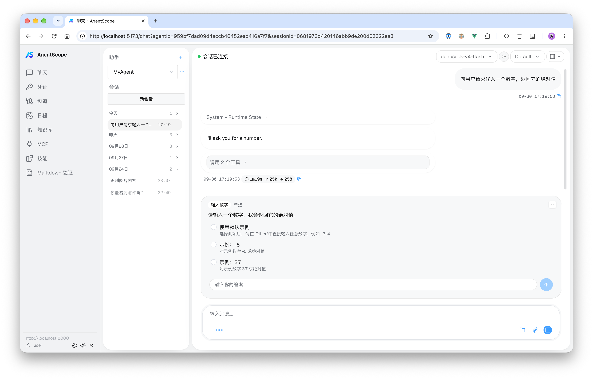
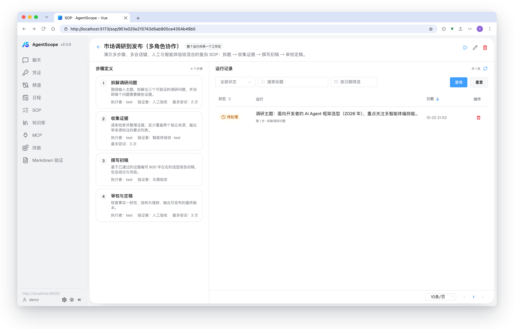
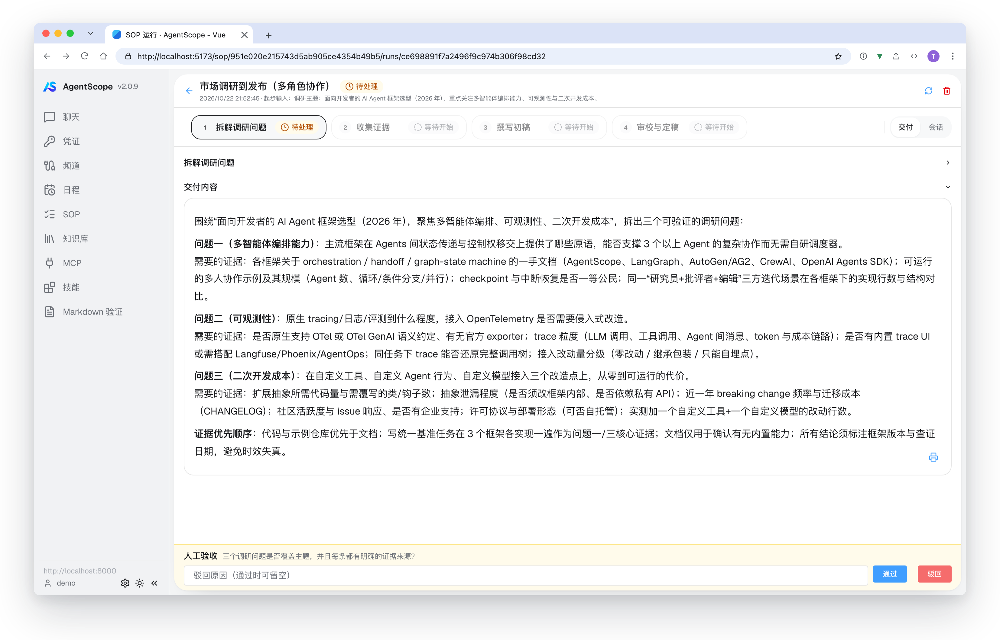

# AgentScope Web UI — Vue 2 迁移版

本项目将 [AgentScope 官方 Web UI 示例](https://github.com/agentscope-ai/agentscope/tree/main/examples/web_ui) 由 React 迁移至 Vue 2，面向国内常见的 Vue 2 老项目技术栈（vue-cli 4，Webpack 4 / 5），在不改变后端协议与交互逻辑的前提下，提供可直接运行、可复用、可二次开发的 Web 控制台。

## 项目背景

原示例基于 React 实现。为便于已有 Vue 2 业务以较低成本接入 AgentScope 的聊天、知识库、MCP、定时任务、SOP 等能力，本项目将其完整迁移为 Vue 组件体系，并保留原有交互逻辑与后端协议。

`package.json` 中的 `version`（当前为 `2.0.9`）表示本项目所对齐的 AgentScope 版本，而非 UI 自身的版本号；侧边栏的版本标识据此链接到对应版本的官方文档。

## 界面预览

<p align="center">
  
</p>

## SOP：多步骤流程编排

SOP（Standard Operating Procedure，标准作业流程）模块支持流程定义、发起运行、步骤进度跟踪以及人工 / 智能体验收。运行详情内嵌只读会话查看器，复用聊天内核的 SSE（Server-Sent Events）与工具授权能力，人在回路（Human-in-the-Loop，HITL）交互均在页面内完成。

- **流程详情**：左侧展示步骤定义，右侧展示运行记录。运行记录支持标题模糊搜索、状态与日期筛选、排序及分页；查询条件同步至 URL，返回页面时自动恢复。
- **运行详情**：顶部步骤条展示各步骤状态并支持切换。「交付」标签页按内容块渲染 Markdown 交付物与验证记录，人工验收时底部提供通过 / 驳回操作，驳回时可填写原因；「会话」标签页实时订阅 SSE，保留工具授权、AskUser 等 HITL 交互。

<p align="center">
  
</p>

<p align="center">
  
</p>

## 技术栈与兼容策略

| 依赖 | 当前实现 | 说明 |
| --- | --- | --- |
| Vue | 2.6.14 | 兼容 Vue 2.6 老项目；模板中的 `?.` / `??` 语法由 `vue-template-babel-compiler` 支持 |
| 构建工具 | vue-cli 4.5 + Webpack 4 | 当前仓库已直接基于 vue-cli 4 运行 |
| 路由 | vue-router 3.x | — |
| 状态管理 | vuex 3.x | — |
| UI 组件库 | Element UI 2.15.x | — |
| 组合式 API | `@vue/composition-api` | 由 [src/plugins/composition-api.js](src/plugins/composition-api.js) 统一注册；业务代码统一从 [src/composables/vue.js](src/composables/vue.js) 桥接导入，升级时只需替换桥接层 |
| 样式 | Tailwind CSS v2（`@tailwindcss/postcss7-compat`）+ Less | 类名、CSS 变量与根容器均做了命名空间隔离，见下文 |
| 旧浏览器兼容 | `abort-signal-polyfill` + core-js | 启动时经 [src/polyfills/index.js](src/polyfills/index.js) 引入，为不支持 `AbortSignal.any / timeout / abort` 的旧浏览器补齐能力；按 CJS 路径引入，以规避老构建工具对 `exports` 字段的限制 |

若现有工程同样使用 vue-cli 4 / Vue 2.6，可直接将 `src/` 下的组件与视图迁移过去，替换或补充路由、store 后即可接入，无需升级 Element UI、vue-router 或 vuex。

### 命名空间隔离

为降低接入既有样式体系时的冲突，项目对类名、CSS 变量与根容器统一加前缀：

- **Tailwind 类名**：在 [tailwind.config.js](tailwind.config.js) 中配置 `prefix: 'tw-'`，工具类均以 `tw-` 开头（如 `tw-flex`、`tw-bg-red-500`），不会与业务全局样式或 Element UI 冲突。
- **CSS 变量**：所有设计令牌（design token）统一以 `--as-` 前缀声明（如 `--as-primary`、`--as-border`），集中定义在 [src/styles/index.css](src/styles/index.css) 的 `:root` / `.dark` 中；Tailwind 主题色再映射到这些变量（如 `colors.primary: 'var(--as-primary)'`）。
- **根容器**：应用根节点 id 为 `as-app`（见 [src/App.vue](src/App.vue)）。`@tailwind base` 预检写在 [src/styles/index.css](src/styles/index.css) 的 `:where(#as-app) { @tailwind base; }` 内，展开后每条预检选择器都会带上 `:where(#as-app)` 作用域，仅作用于 `#as-app` 内部，避免影响宿主系统。
  - 面向 `html` / `body` 的预检规则会变成 `:where(#as-app) html` 而永不匹配，因此 `tab-size`、`line-height` 等根级声明不再作用于 `#as-app` 自身；宿主页面的 `html, body { margin: 0 }` 保留在文件顶层，未加作用域。
  - 该写法生成原生 CSS 嵌套，要求浏览器支持 CSS Nesting（Chrome/Edge 112+、Safari 16.5+、Firefox 117+）。
- **原子类**：少量从 Tailwind 任意值语法中抽离出的原子类统一放在 `as-` 前缀的 [src/styles/atomic.css](src/styles/atomic.css) 中。

如需更改或移除上述前缀，只需调整对应配置，并借助代码中统一的 `tw-` / `--as-` 标记做全局查找替换，改造成本较低。

## 快速开始

包管理器为 pnpm，以下命令均在仓库根目录执行。

```bash
pnpm install       # 安装依赖
pnpm dev           # 启动开发服务（默认端口 5173）
pnpm build         # 生产构建
pnpm preview       # 预览构建产物
pnpm test:unit     # 运行单元测试
pnpm format        # 按 Prettier 规则格式化
pnpm format:check  # 检查格式
```

前端支持两种后端接入方式：直连 Python（默认），或经 Java 服务中转。默认直连地址为 `http://localhost:8000`，可在 setup 页修改并持久化到 `AppStorageKeys.SERVER_URL`。

提交前建议执行 `pnpm test:unit` 与 `pnpm build`。

## 接口与后端接入

所有请求由端点映射表驱动：业务代码只调用 `client.request(key, { pathParams, params, body, ... })`，不直接拼接 URL。

- **映射表**：[src/api/mapping.js](src/api/mapping.js) 是端点定义的唯一真源（SSOT）。每个端点对应一个 key，分别声明 `direct`（Python 直连）与可选的 `proxy`（Java 中转）的 `{ method, path }`；路径参数写作 `{xxx}`，由 `resolveEndpoint` 插值并做 URL 编码。
- **模式切换**：由 `AppStorageKeys.API_MODE`（存储键 `api_mode`）控制，取值为 `direct`（默认）或 `proxy`。模式在 setup 页选择，并随连接配置经 Vuex `app/saveConfig` 持久化。

| 模式 | Base URL | Method | 说明 |
| --- | --- | --- | --- |
| `direct`（默认） | 直连地址，如 `http://localhost:8000` | GET / POST / PATCH / DELETE | 直连 Python 后端 |
| `proxy` | 含中转前缀的地址，如 `http://hostname/proxy/api/` | 仅 GET / POST | 经 Java 中转：PATCH → `POST {path}/update`，DELETE → `POST {path}/delete` |

> Base URL 取自 `AppStorageKeys.SERVER_URL`（存储键 `as-server_url`）；所有 localStorage 键的单一真源为 [src/constants/app-state.js](src/constants/app-state.js) 的 `AppStorageKeys`。

```js
import { API_MODES } from '@/api';
import { AppStorageKeys } from '@/constants/app-state';

// 绕过 setup 页直接切换时：同时改写模式与中转地址
localStorage.setItem(AppStorageKeys.API_MODE, API_MODES.PROXY);
localStorage.setItem(AppStorageKeys.SERVER_URL, 'http://hostname/proxy/api/');
// 此后全部请求自动使用中转地址与 GET/POST 映射
```

> 所有 localStorage 键的单一真源为 [src/constants/app-state.js](src/constants/app-state.js) 的 `AppStorageKeys`。

- **接口文档**：直连清单见 [docs/API.md](docs/API.md)；Java 中转映射版（含映射后的 URL / Method，以及 SSE、multipart、文件下载等特殊场景说明）见 [docs/API-java-proxy.md](docs/API-java-proxy.md)。
- **特殊响应**：SSE 事件流（`stream: true` 返回原始 `Response`）、multipart 上传（XHR）与带 token 的文件下载同样从映射表取路径。中转层需按文档说明做流式或二进制透传，不能按普通 JSON 处理。

## 目录结构

```text
src/
├── api              # 后端接口封装 + 端点映射表（mapping.js：direct 直连 / proxy Java 中转）
├── assets           # 图片、字体等静态资源
├── components       # 业务组件（chat、panel、dialog、drawer、form、sop、layout、ui、iconify 等）
├── composables      # 组合式逻辑
├── constants        # 常量集中地（app-state.js：App* 枚举 + AppStorageKeys 本地存储键；protocol.js：外部协议）
├── lib              # 工具库 / 第三方适配
├── plugins          # 插件注册（composition-api、element、fonts、styles 各自独立的 setup 函数）
├── polyfills        # 旧浏览器能力补齐（AbortSignal 等）
├── router           # 路由
├── store            # Vuex 状态
├── styles           # 全局样式：index.css（作用域化的 @tailwind base 预检 + Tailwind + CSS 变量）、atomic.css、element-overrides.less、Less 变量
├── utils            # 工具函数
└── views            # 页面视图（chat、setup、knowledge、mcp、schedule、skill、sop 等）
```

仓库根目录另有 `docs/`：

- [API.md](docs/API.md)：直连清单，与 `direct` 模式一一对应。
- [API-java-proxy.md](docs/API-java-proxy.md)：Java 中转映射版，含映射后的 URL / Method 与 SSE、multipart、文件下载等特殊场景说明。
- [STRUCTURE.md](docs/STRUCTURE.md)：项目文件结构对照（当前 Vue 项目 ↔ 官方 React 项目）。
- [DATA-FLOW.md](docs/DATA-FLOW.md)：数据流向说明，以 `src/views/chat/index.vue` 发起会话为例做端到端追踪。

## 扩展：监听工具执行结果

聊天 SSE 事件由 [src/store/modules/chat.js](src/store/modules/chat.js) 的 `processEvent` 统一分发。若需在工具（如 `Bash`）执行完成后处理结果，可向 `useMessages` 的 `callbacks.tools` 传入监听表：

```js
useMessages(effectiveAgentId, effectiveSessionId, {
  tools: {
    Bash: (tool) => {
      // tool = { name, input, output }
      // input：工具调用参数经流式累积后的完整 JSON 字符串
      // output：ToolResultBlock 的结果块数组
    },
    'mcp__github__create_issue': (tool) => {},
    '*': (tool) => {}, // 未命中具体工具时的兜底
  },
});
```

监听时机为 `TOOL_RESULT_END`，此时消息状态已完成更新，回调中的 `input` / `output` 为该次调用的完整数据；`findToolBlocks`（[src/utils/agentscope.js](src/utils/agentscope.js)）负责从消息块中反查对应内容。

## 向后兼容与 Vue 3 升级

本仓库提供两种接入路径：

1. **直接用于 Vue 2.6 老项目**：将 `src/` 源码迁移至 Vue 2.6.14 + vue-cli 4 工程。Element UI 2.x、vue-router 3.x、vuex 3.x 均无需升级，改动成本最低。全局依赖（`@vue/composition-api`、Element UI、字体、样式）已拆分为 `src/plugins` 下各自独立的 setup 函数，入口只需调用 `setupPlugins(Vue)`；旧版浏览器所需的 `AbortSignal` 等能力由 `src/polyfills` 补齐。
2. **升级至 Vue 3**：当前代码已统一使用 Composition API 风格（通过 `src/composables` 桥接层导入）。升级时替换桥接层与 `src/plugins` 中的注册逻辑为 Vue 3 内置 API 即可；Element UI 可替换为 Element Plus，vue-router 与 vuex 分别升级至 4.x，整体迁移量可控。

## 待办事项

- **会话消息分页**：`openConversation` 目前一次加载最新 200 条（接口单页上限），超过 200 条的会话无法查看更早的消息。后续可使用响应中的 `has_more` 与当前页最早一条的 `id`（作为 `before`）循环补齐；该接口为游标分页且不返回总数，只能加载完成后累计。

## 相关链接

- [AgentScope 官方仓库](https://github.com/agentscope-ai/agentscope)
- [原 Web UI 示例](https://github.com/agentscope-ai/agentscope/tree/main/examples/web_ui)
- [AgentScope 官方文档（中文，2.0.9）](https://docs.agentscope.io/zh/versions/2.0.9)

## 开源许可

本项目基于 [Apache License 2.0](LICENSE) 许可开源：

```text
Copyright 2026 hongxin.tang@hotmail.com

Licensed under the Apache License, Version 2.0 (the "License");
you may not use this file except in compliance with the License.
You may obtain a copy of the License at

    http://www.apache.org/licenses/LICENSE-2.0
```

本项目衍生自 AgentScope 官方 Web UI 示例（上游同样采用 Apache License 2.0），上游版权与衍生关系说明详见 [NOTICE](NOTICE)。
